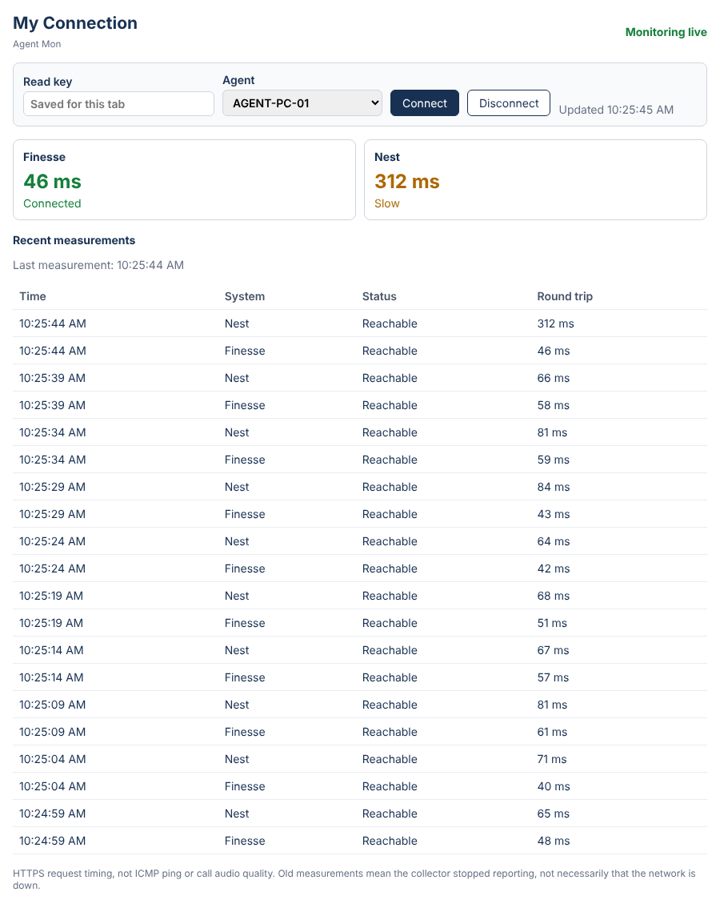

# Agent Mon

Agent Mon checks whether a contact-center agent's computer can reach the systems it depends on, such as Cisco Finesse, and how quickly. A small program on the agent's PC (the **collector**) tests each system every few seconds and sends the results to a **server**. A web page (the **dashboard**) shows the results.



> **Status: version 1.0.** The collector, server and dashboard are tested together end to end. It is not a Cisco-certified Finesse gadget and hasn't been tested against a live Finesse server yet. The server keeps results in memory only. See [Before rolling it out](#before-rolling-it-out).

## What it measures, and what it doesn't

- It measures how long an HTTPS request to each system takes, and whether the system answers.
- It does **not** measure ping (ICMP) or call audio quality.
- Old results mean the collector stopped reporting. That doesn't prove the network is down.

## Quick start (downloads, no .NET needed)

1. Download the zip for your system from the [latest release](https://github.com/jcliff01/agent-mon/releases/latest): `win-x64` (Windows), `osx-arm64` (Apple silicon Mac), `osx-x64` (Intel Mac) or `linux-x64`. Unzip it.
2. Open a terminal in the unzipped folder and make two secret keys (step 3 below).
3. Start the server: `./AgentMon.Server` (on Windows: `.\AgentMon.Server.exe`).
4. In a second terminal, set the write key and targets (step 5 below), then start the collector: `./AgentMon.Collector` (Windows: `.\AgentMon.Collector.exe`).
5. Open [http://127.0.0.1:5088](http://127.0.0.1:5088), paste the **read key**, and click **Connect**.

On macOS, if the system says the program can't be opened, right-click it, choose **Open**, then **Open** again. The programs aren't code-signed.

## Running from the source code

### Step 1: Install the .NET 8 SDK

**Windows:** open PowerShell and run:

```powershell
winget install Microsoft.DotNet.SDK.8
```

**macOS:** download and run the macOS installer from [dotnet.microsoft.com/download/dotnet/8.0](https://dotnet.microsoft.com/download/dotnet/8.0). Choose **Arm64** for Apple silicon Macs (M1 or later) or **x64** for Intel Macs.

**Linux (Ubuntu 22.04 or later):**

```sh
sudo apt-get update && sudo apt-get install -y dotnet-sdk-8.0
```

Close the terminal and open a new one. Check that it worked: `dotnet --version` should print a number starting with 8.

### Step 2: Get the code

Either click the green **Code** button on this page, choose **Download ZIP** and unzip it, or run:

```sh
git clone https://github.com/jcliff01/agent-mon.git
```

Then open a terminal in the `agent-mon` folder.

### Step 3: Make two secret keys

The collector uses a **write key** to send results; the dashboard uses a separate **read key** that can only read them. Make two long random keys:

**Windows (PowerShell):**

```powershell
$env:AGENTMON_API_KEY  = [guid]::NewGuid().ToString('N') + [guid]::NewGuid().ToString('N')
$env:AGENTMON_READ_KEY = [guid]::NewGuid().ToString('N') + [guid]::NewGuid().ToString('N')
```

**macOS or Linux:**

```sh
export AGENTMON_API_KEY=$(openssl rand -hex 32)
export AGENTMON_READ_KEY=$(openssl rand -hex 32)
```

The keys only last while this terminal window is open. Print them with `echo $env:AGENTMON_API_KEY` (Windows) or `echo $AGENTMON_API_KEY` (macOS/Linux) so you can use them in the next steps.

### Step 4: Start the server

In the first terminal:

```sh
dotnet run --project server/AgentMon.Server
```

It listens on `http://127.0.0.1:5088`, which only this computer can reach. Leave it running.

### Step 5: Start the collector

Open a second terminal in the same folder and set the same `AGENTMON_API_KEY` (the write key, not the read key). Then tell the collector what to test. Give each address a name; the name is what the dashboard shows.

**Windows (PowerShell):**

```powershell
$env:AGENTMON_API_KEY = "<the write key from step 3>"
$env:AGENTMON_TARGETS = "Finesse=https://finesse.example.com/,Nest=https://nest.example.com/health"
dotnet run --project collector/AgentMon.Collector
```

**macOS or Linux:**

```sh
export AGENTMON_API_KEY="<the write key from step 3>"
export AGENTMON_TARGETS="Finesse=https://finesse.example.com/,Nest=https://nest.example.com/health"
dotnet run --project collector/AgentMon.Collector
```

Replace the example addresses with your own. Press **Ctrl+C** to stop either program.

### Step 6: See the results

Open [http://127.0.0.1:5088](http://127.0.0.1:5088) in a browser. Paste the **read key**, click **Connect**, and pick the agent (by default, the collector's computer name). The dashboard updates every 5 seconds. The key is kept only for that browser tab.

## Settings

| Setting | Used by | What it does |
| --- | --- | --- |
| `AGENTMON_API_KEY` | server and collector | Write key, at least 32 characters. Required. |
| `AGENTMON_READ_KEY` | server | Read-only key for the dashboard, at least 32 characters and different from the write key. Recommended. Without it, the dashboard needs the write key. |
| `AGENTMON_TARGETS` | collector | Comma-separated `Name=https://address` pairs, up to 50. Required. |
| `AGENTMON_ENDPOINT` | collector | Server address. Default `http://127.0.0.1:5088`. Must be HTTPS unless it is this computer. |
| `AGENTMON_AGENT_ID` | collector | Name for this PC in the results: letters, digits, `.`, `-` or `_`. Default: the computer name. |
| `AGENTMON_INTERVAL_SECONDS` | collector | How often to test, 1 to 300 seconds. Default 5. |
| `AGENTMON_URLS` | server | Address the server listens on. Default `http://127.0.0.1:5088`. |
| `AGENTMON_DASHBOARD_DIR` | server | Folder holding the dashboard. Default: the `dashboard` folder next to the server. |

## Server API

Send the key in an `X-AgentMon-Key` header.

| Request | Key | What it does |
| --- | --- | --- |
| `GET /healthz` | none | Returns `{"status":"ok"}` when the server is running. |
| `POST /api/v1/samples` | write | Adds one result. The collector does this. |
| `GET /api/v1/agents` | read | Lists agents with their last report time. |
| `GET /api/v1/agents/{agentId}/samples` | read | The latest 120 results for one agent. |
| `GET /dashboard/` | none | The dashboard page. It asks for the read key. |

## Running the server in Docker

```sh
docker build -t agent-mon .
docker run -p 5088:5088 -e AGENTMON_API_KEY=<write key> -e AGENTMON_READ_KEY=<read key> agent-mon
```

## Finesse integration

The dashboard page also works as the core of a Finesse gadget. An authenticated integration calls `window.AgentMon.render(samples)`, which hides the key form. See [docs/agent-live-monitor.md](docs/agent-live-monitor.md) and [docs/finesse-15.md](docs/finesse-15.md).

## Troubleshooting

| Message | What to do |
| --- | --- |
| `Set AGENTMON_API_KEY to …` | Do step 3 in this terminal window. |
| `AGENTMON_TARGETS: "…" isn't an https:// address` | Each address must start with `https://`. Separate targets with commas. |
| `Can't deliver results to the server` | The server isn't running, or the two windows have different write keys. The collector keeps retrying and says when it's delivering again. |
| `That key was refused.` on the dashboard | Use the read key (or the write key if you didn't set a read key). |
| `No agents have reported yet` | Start a collector with the same write key, wait a few seconds, then click **Connect** again. |
| `dotnet: command not found` or not recognized | Open a new terminal after installing .NET, or reinstall it (step 1). |

## Before rolling it out

- **HTTPS:** put the server behind an HTTPS reverse proxy (for example IIS, nginx or Caddy) and point collectors at the `https://` address.
- **Storage:** results are kept in memory (the latest 120 per agent, up to 5,000 agents) and are lost when the server restarts.
- **Keys:** every collector shares one write key. Rotate it by restarting the server and collectors with a new one.
- **Finesse:** package the dashboard as a supported Finesse gadget and test it against your Finesse 15 servers ([docs/finesse-15.md](docs/finesse-15.md)).
- Never log passwords, call content or customer data, and remove keys and internal host names from anything you share.

## For developers

```sh
dotnet test tests/AgentMon.Tests
```

To publish a release, set `<Version>` in `Directory.Build.props`, add a section to [CHANGELOG.md](CHANGELOG.md), and push a matching tag such as `v1.0.0`. The **Release** workflow runs the tests and attaches ready-to-run zips for Windows, macOS and Linux, with SHA-256 checksums.

## License

[MIT](LICENSE).
